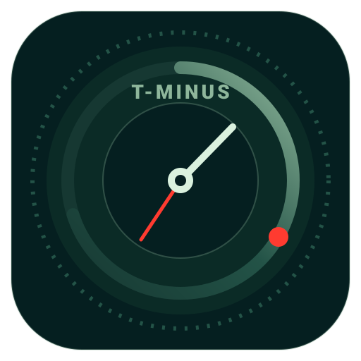

# T-Minus Countdown & Milestone Dashboard

A zero-backend, client-side, production-grade productivity dashboard engineered with React 18, Tailwind CSS, custom pointer-event physics, 8-way directional matrix resizing, multi-calendar synchronization, and PWA + Capacitor mobile packaging.



---

## Features

- **Adaptive Countdown Engine**:
  - Live real-time precision countdown (Days, Hours, Minutes, Seconds).
  - Sub-24h urgent radial gauge view with crimson glow dial (`#FF3B30`).
  - Multi-timezone switching: **IST**, **UTC**, **EST**, and **PST**.
  - Target event reached completion state handling.

- **Interactive 2D Matrix Widget System**:
  - 8-column responsive grid with physics-based pointer tracking.
  - 8-way directional edge and corner resizing (`nw`, `ne`, `sw`, `se`, `n`, `s`, `e`, `w`).
  - Collision resolution with downward gravity compaction to prevent layout drift.
  - Coordinate Mode ("Grid Mode" / "Lock Grid") with auto-fit presets.
  - Tactile haptic feedback on drag, drop, resize, and milestone check.

- **Custom Sprint & Milestone Manager**:
  - Full customization: Edit event title and target deadline date/time directly in the UI.
  - Add custom milestones with tags (`T-10`, `T-5`, etc.), titles, descriptions, and dates.
  - Delete or toggle milestone completion.
  - 1-click factory reset to restore default portfolio sprint roadmap.
  - All state safely persisted in `localStorage`.

- **Multi-User Calendar Synchronization**:
  - **Zero-Backend Bulk Export**: Generate and download standard `.ics` calendar files (Apple Calendar, Microsoft Outlook, Windows/Android system calendar).
  - **Individual Google Calendar Links (`+GCal`)**: 1-click web intent with pre-filled title, timing, and descriptions.
  - Client-side OAuth architecture documented for direct silent background sync.

- **Apple Frosted Glass & Tactile Neumorphism Design**:
  - **Dark Mode**: High-contrast Apple frosted glass panels with subtle border highlights and glow effects.
  - **Light Mode**: Tactile neumorphic surfaces with raised and sunken shadows.
  - Blueprint matrix overlay when dragging or resizing widgets.

- **Mobile First & Native Distribution**:
  - **PWA (Progressive Web App)**: Installable directly from Safari (iOS) or Chrome (Android) home screen with offline service worker caching (`manifest.json` & `sw.js`).
  - **Capacitor 6 Ready**: Ready for packaging into native iOS (.ipa) and Android (.aab/.apk) apps with haptic vibrations and local notifications.

---

## Quick Start

### 1. Zero Build Step (Direct Browser Open)
Double-click `index.html` to open it in any modern browser (Chrome, Safari, Edge, Firefox). No Node.js build step or runtime server is required.

### 2. Local HTTP Server
Run with npm:
```bash
npm start
```
Or with Python:
```bash
python -m http.server 3000
```
Open [http://localhost:3000](http://localhost:3000) in your browser.

---

## Native Mobile App Packaging (Capacitor)

To wrap the web app as native iOS and Android applications:

```bash
# 1. Install dependencies
npm install

# 2. Add native iOS and Android projects
npx cap add ios
npx cap add android

# 3. Sync web assets into native wrappers
npm run cap:sync

# 4. Open in Xcode or Android Studio
npm run cap:open:ios
npm run cap:open:android
```

---

## Project Structure

```
CountDown/
├── index.html                                    # Main dashboard application
├── manifest.json                                 # Web App Manifest (PWA)
├── sw.js                                         # Service Worker (Offline Cache)
├── favicon.png                                   # Browser favicon
├── capacitor.config.json                         # Capacitor native app configuration
├── package.json                                  # Scripts and dependencies
├── .gitignore                                    # Git ignore rules
├── icons/                                        # App icons
│   ├── icon-192x192.png                          # 192px maskable PWA icon
│   ├── icon-512x512.png                          # 512px maskable PWA icon
│   └── icon.svg                                  # High-res vector icon
├── scripts/
│   └── generate_icons.py                         # Standalone icon generator
├── countdown_milestone_dashboard_documentation.md # Technical documentation
└── mobile_app_deployment_native_packaging_guide.md# Native packaging reference
```

---

## License

MIT
